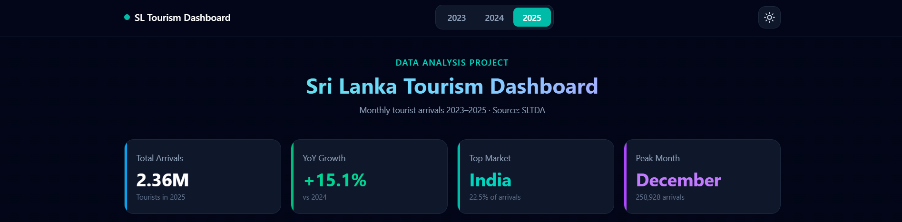
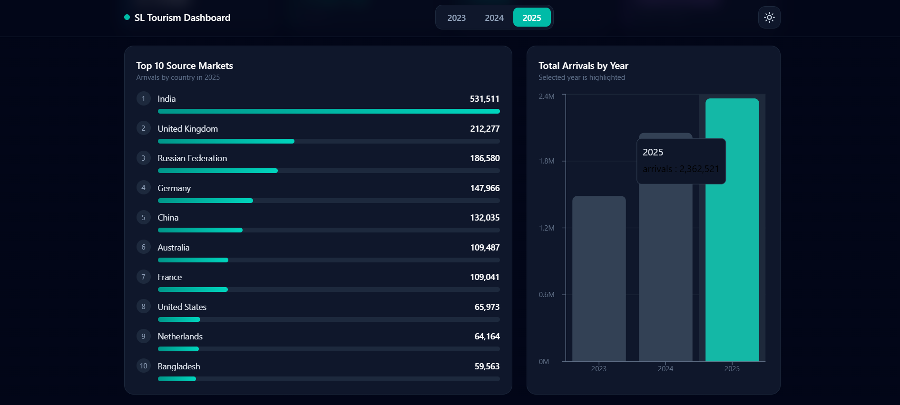
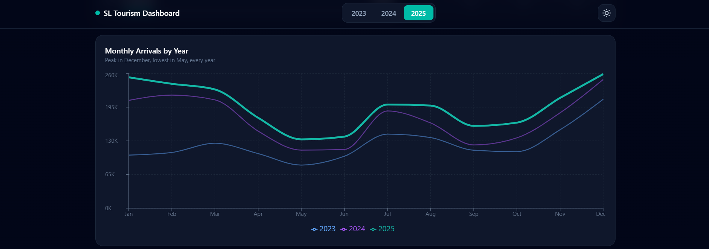
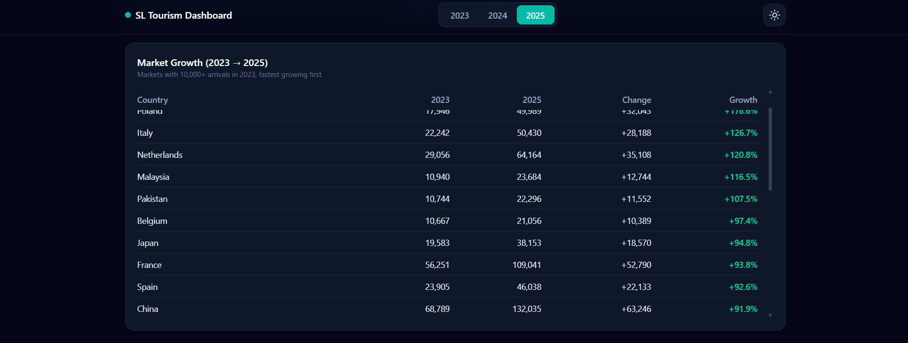
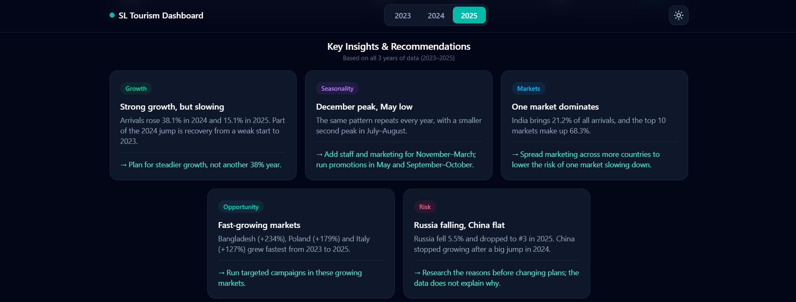

# 🇱🇰 Sri Lanka Tourism Dashboard (Web)

An interactive web dashboard of monthly tourist arrivals to Sri Lanka (2023–2025), with key insights and business recommendations.

### 🌐 Live: [sl-tourism-dashboard.vercel.app](https://sl-tourism-dashboard.vercel.app/)

This is the web version of my **[Sri Lanka Tourism Data Analysis](https://github.com/shihariAyodya/sri-lanka-tourism-analysis)** project, where the data was cleaned with Python, analyzed with MySQL and first visualized in Power BI.



---

## ✨ Features
- **Year selector** (2023, 2024, 2025) in a sticky navbar that stays visible while scrolling
- **KPI cards:** total arrivals, year-over-year growth, top market and peak month
- **Top 10 source markets** as a ranked list with progress bars
- **Total arrivals by year,** with the selected year highlighted
- **Monthly seasonality chart** comparing all 3 years
- **Market growth table (2023 → 2025),** with growth in green and declines in red
- **Key insights and recommendations** for tourism businesses
- **Light and dark theme,** remembered between visits
- **Responsive layout** for desktop, tablet and phone

---

## 📸 Screenshots

**Top 10 source markets and arrivals by year**


**Monthly seasonality**


**Market growth (2023 → 2025)**


**Key insights and recommendations**


---

## 🛠️ Tech Stack
| Tool | Used for |
|---|---|
| React (Vite) | Building the page and handling the year selection |
| Tailwind CSS | Styling, layout and light/dark theme |
| Recharts | Bar and line charts |
| PapaParse | Reading the CSV data in the browser |
| Vercel | Hosting and automatic deploys from GitHub |

---

## 📊 Data
- **Source:** Sri Lanka Tourism Development Authority (SLTDA), [Monthly Tourist Arrivals Reports](https://sltda.gov.lk/monthly-tourist-arrivals-reports)
- **File:** `public/data/tourism_long.csv`, with 6,936 rows (Country, Year, Month, Arrivals, Month_Num)
- All numbers on the dashboard are calculated in the browser from this file, and they match the Python, SQL and Power BI results.

---

## 🚀 Run Locally
```bash
git clone https://github.com/shihariAyodya/sl-tourism-dashboard.git
cd sl-tourism-dashboard
npm install
npm run dev
```
Then open http://localhost:5173

---

## 📁 Structure
```text
├── images/                     # Screenshots for this README
├── public/
│   └── data/tourism_long.csv   # Clean dataset
├── src/
│   ├── App.jsx                 # Dashboard: calculations, charts and layout
│   ├── index.css               # Tailwind import and dark mode setup
│   └── main.jsx                # React entry point
├── index.html
└── vite.config.js              # Vite + Tailwind plugin
```

---

## 👤 Author
**Shihari Ayodya**, Information Systems Undergraduate, Sabaragamuwa University of Sri Lanka
[GitHub](https://github.com/shihariAyodya) · [LinkedIn](https://linkedin.com/in/shihari-ayodya-33406a34b) · [Portfolio](https://shihari.vercel.app/)
